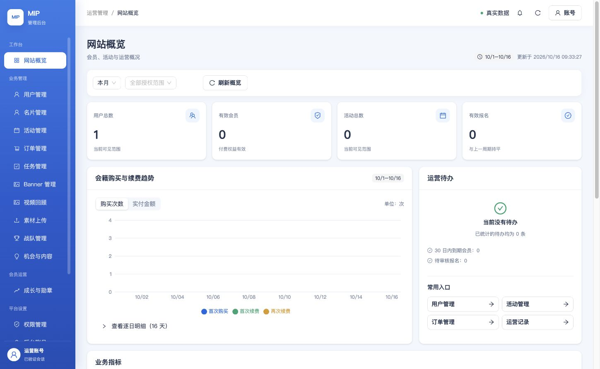

# 测试管理员开通与密码登录验收（2026-10-16）

结果：**PASS**。已为用户本人通过测试小程序注册、验证手机号并选择主分会的身份开通测试环境 `PLATFORM_OWNER`，首次绑定用户指定密码，并在 <https://test.admin.mip.cool/> 完成真实浏览器密码登录、刷新及退出。手机号、密码、用户标识、微信身份、cookie、登录码和运行密钥均不入本记录。

本轮操作基于交付分支源提交 `79779088`，只进行测试账号配置、运行验证与文档更新，未重新构建或部署网站、小程序、云函数。仓库主 checkout 的并行工作未修改。

## 开通过程与真实身份

1. 从测试 identity/admin/BFF 云端回读确认业务库 `mip_test`、认证库 `mip_test_admin_auth`、测试上游及目标 origin。
2. 只读定位到唯一 ACTIVE 非演示用户，核对服务端已验证手机号、昵称、当前协议及用户本人刚选择的启用主分会。通过仓库受控 `bootstrap-owner`，精确确认环境与用户，写入测试 Owner 绑定和 1 条 `admin.owner.bootstrap` 审计。
3. 首次密码绑定前创建真实 BFF challenge。复用已登录微信开发者工具与先前已验证的测试预览包，核对运行 AppID、实际测试身份服务返回的 `userId` 与目标注册用户完全一致，且 `phoneBound=true`；通过现有现场工作台的输入、确认 handler 发起真实微信确认。没有注入 OpenID/principal、模拟确认、替换用户或复制生产认证数据。
4. BFF 正常消费其自身 challenge cookie，取得真实近期 WECHAT 会话，服务端管理会话确认启用；按用户明确授权，通过现有 `/api/auth/password` 首次绑定指定密码，然后退出该会话。

这里的微信确认来自**开发者工具真实测试身份**，不记作手机扫码验收。用户手机号注册及主分会选择已由本人在测试小程序完成；本轮通过服务端记录回读核实。以后正常密码登录不需要重复进行这次首次绑定确认。

本机测试配置没有保存手机号校验密钥；这不代表云端 identity/admin 的密钥不一致。本轮进程使用目标云端已核实值执行受控手机号定位，没有修改云端密钥，也没有把生产配置混入测试。

## 验收结果

| 检查 | 结果 | 证据 |
| --- | --- | --- |
| 测试 Owner、主分会及初始化审计回读 | PASS | [activation.public.json](activation.public.json)：1 个目标密码凭据、1 条初始化审计 |
| 本机真实微信身份与目标注册用户一致、现有工作台确认成功 | PASS | [devtools-confirm.public.json](devtools-confirm.public.json) |
| 真实 challenge 消费、管理会话、首次密码绑定及退出 | PASS，6 项 | [auth-flow.public.json](auth-flow.public.json) |
| HTTPS 密码认证与受保护接口 | PASS，14 项 | [password-verification.public.json](password-verification.public.json) |
| Computer Use：密码登录、真实数据概览、刷新保持会话 | PASS | [browser-verification.public.json](browser-verification.public.json)、下方截图 |
| Computer Use：非空用户列表、掩码手机号、测试分会 | PASS，1 行 | 同上；含个人资料的页面截图不提交 |
| Computer Use：活动管理可访问、新建入口可见、空列表与政策读取 | PASS，仅访问与读取 | 0 个活动，不代表活动写入通过 |
| Computer Use：账号菜单退出后重新要求登录 | PASS | 同上；浏览器最终停留在未登录状态 |

接口 14 项包含：未登录拒绝、非可信 Origin 拒绝、错误密码拒绝、正确密码登录、Secure/HttpOnly/SameSite=Lax cookie、真实启用的 Owner 会话、概览/用户/活动读取、退出、退出后旧 cookie 重放拒绝、再次密码登录及最终退出。用户列表返回 1 行；活动列表返回 0 行，明确区分非空字段结构与空态证据。

## 写入范围与交接

- 本轮服务端写入限于 `mip_test` 的目标 Owner 绑定/审计，以及 `mip_test_admin_auth` 的登录 challenge、密码凭据、会话和认证计数。业务验证阶段只读取概览、用户、活动，无活动、订单或支付写入。
- 正式和测试仍是同 CloudBase 环境、同 MySQL 实例内的逻辑隔离，分别使用业务库、认证库、函数、运行账号和密钥；本轮不改变[此前隔离核查](../admin-test-isolation-20261016/README.md)的物理隔离边界。没有向生产库或生产认证库写入。
- 用户指定密码的临时输入文件已删除；原始配置、认证响应、用户数据与私有运行截图仅留本机忽略目录，文件限制为本机私有访问，不进入 Git。
- 发现一项待修正文案：当前测试预览包的工作台仍提示核对 `admin.mip.cool`，实际测试登录码已由测试 BFF 正常消费，密码登录也使用测试入口。下次测试小程序构建应将 `brand.adminConsoleDomain` 的显示提示与测试目标一致；本轮未发布小程序，不把该文案记作正确。
- 后续 AI 从[测试后台交接](../../ADMIN_TEST_DOMAIN_HANDOFF.md)继续。账号认证已通过；活动创建/编辑、富文本与媒体、报名、订单、退款和其他角色仍按独立产品验收标准逐项实测，本报告不宣称全后台功能验收完成。
