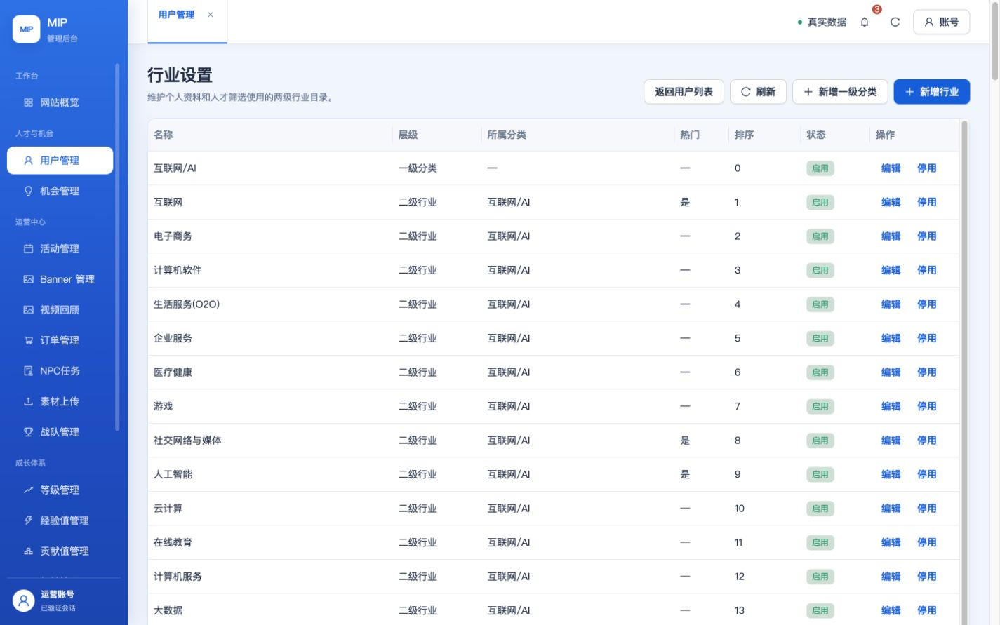
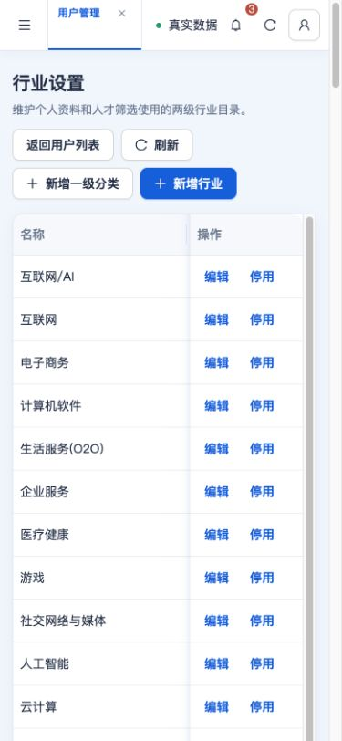

# 超级管理员行业维护与发布证据（2026-10-20）

入口：用户管理 → 行业设置（`/users/industries`）。支持两级目录、新增、改名、归属、热门、排序和启停；仅 PLATFORM_OWNER 可维护，服务端再次校验 owner、AppID、版本与幂等键，审计包含 before / after。新增项默认停用，不物理删除历史引用。代码已合并并推送 main，运行代码基点 `08a034a0ddd66a23d892ce8a94ce2b9174a59945`。

行业初始值来自 AME 飞书 2026-09-26 revision62 快照（11类、121个子行业），导入到 `mip_tags` 后由数据库供个人资料与筛选读取，不是实时同步飞书。2026-08-22会议纪要说明两级行业与飞书表单维护；本次用户明确要求超级管理员自定义，已纳入唯一后台验收标准 U10。后台自定义之后，旧飞书整库导入会停止，防止覆盖运营配置。官方 Figma 的读取与六枚 SVG 下载已验证，见[连通证据](../figma-official-20261019/README.md)。

## 真实测试环境

[测试后台](https://test.admin.mip.cool/#/users/industries) 已更新3个业务函数、BFF和15个静态文件。追加迁移111（版本 `20261020010000`）仅应用到 `mip_test`；运行账号152张表的最小权限清单核对通过。4个实际下载函数包与当前运行源码一致，原函数权限、角色、网络和触发器边界保留；BFF仅更新代码指纹环境键。标准测试部署同时将 `mip-t-cloudpay` 的客户端直调设为 false，其他生产权限条目未变，见[云端包回读](cloud-release-verification.json)。

15/15 HTTPS静态文件逐字节匹配，登录及14个读模块的68项检查通过，见[静态资源](test-assets-verification.json)与[HTTPS检查](test-https-verification.json)。真实接口完成新增、改名、热门/排序保存、重复名称拒绝、过期版本拒绝、停用父分类拒绝新增启用子项等检查。真实浏览器完成用户列表入口、编辑、保存和刷新回读；1280×720、1440×900、390×844页面宽度均未溢出，手机侧栏折叠，表格在自身容器内展示。截图：

网页编辑首次收到一次非标准响应并显示“管理 API 返回格式无效”；当时服务端回读仍为旧值。同一幂等键重试后成功，名称、热门、排序与刷新回读一致。首次非标准响应的根因证据不足，不能宣称已修复。截图保留为 [提交异常](industry-save-error.png)，异常提示如何处理已提前向用户确认，回答前不发布生产后台。

## 停用后的历史保留

用户确认：仅限制新选择，历史选择保留；停用一级分类后，其下行业从新选项隐藏，但不删除原数据。个人资料快照返回原行业ID/名称；已有引用可保留，新选择检查行业和父分类启用。目录失败可继续保存其他资料；省略行业字段保留，显式 null 清除，兼容旧客户端。后台机会、案例及人才/公开资料消费者同步核对。

微信开发者工具连接真实测试库后，实际完成选择并保存、停用行业后保存、停用父分类后保存、清除以及拒绝新增停用行业。验收中发现旧编译会话的页面锁导致重复调用并未发请求，前一轮重复保存结论已撤回；完整重新编译、重连后逐次核对真实写入的版本3→4→5→6→7，每次确认离开页面，再新建页面等待服务端读取完成。最终原行业选择恢复为空；新增停用行业返回“资料标签不存在或当前不可用”，重读仍为空、版本仍为7。两条验收目录最终均停用，只存在于测试库。[运行时逐项结果](runtime-industry-retention.json)。这些是开发者工具与云端证据，真机验收仍由用户执行。

## 发布边界与待确认

完整本地 `TZ=Asia/Shanghai pnpm verify:all` 已通过（小程序1811、Web Node329、Web React247；含构建、预算、源码及响应式检查），runtime:preflight通过，日志 `.tmp/industry-config-20261019/verify-all-history.log`。本目录原来的 `industry-1280/1440/390.png` 等截图仍是明确标注的本地隔离内存夹具，不应混作上述真实云端截图。

全量云端检查发现历史配置不一致：`mip-t-payment-ledger` 为 staging / TEST / live，当前测试目标为 staging / TEST / disabled，且测试会籍维护配置尚未收敛。已询问是否按测试约定修正，尚未改动账本配置、订单或权益。不能把行业专项与HTTPS通过写成完整 cloud:verify 通过。

生产库已在仓库外完整备份：154表、5521行，2026-10-20 04:45:53 UTC完成，row-count-verified，见[摘要](production-backup-summary.json)。生产迁移、业务函数与后台均未发布；生产业务数据写入为0。生产原函数包另有本机私有备份，包括后续后台发布需要配套的媒体解析接口。

小程序候选版本为 `0.2.0.20261020.1`，本轮上传流程已在上传前停止，未上传、未设体验版、未提审、未发布正式版，也没有遗留的延迟上传进程。等待用户确认测试支付配置和网页异常提示方案后继续；重新上传时仍必须重新执行完整发布门禁。最终机器状态见[verification.json](verification.json)。
