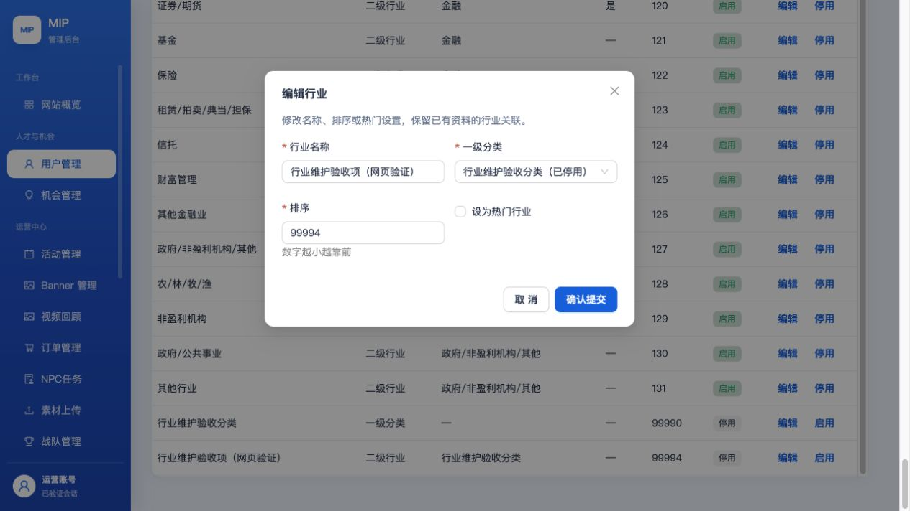
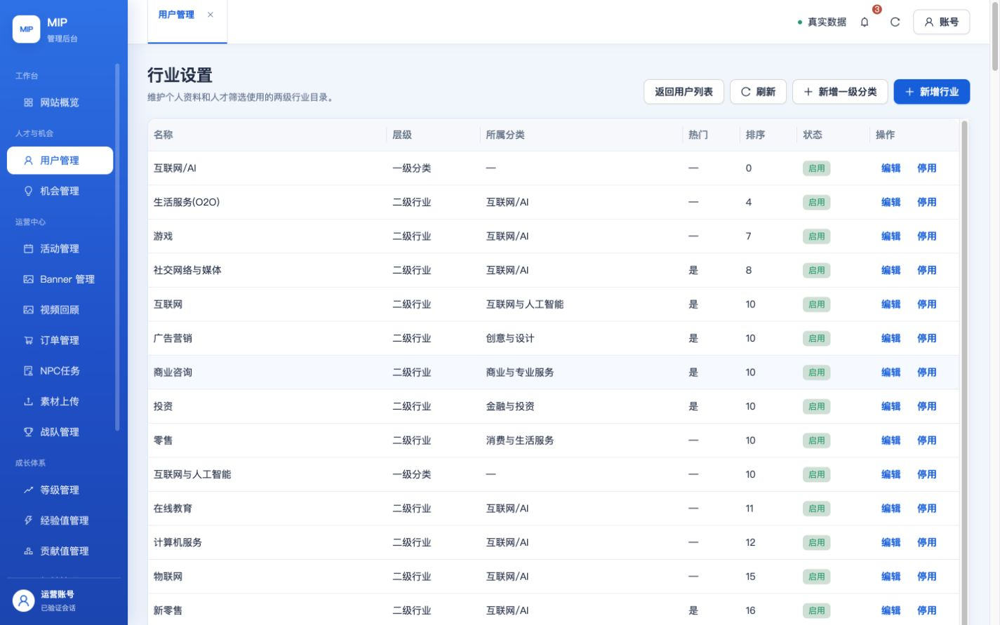
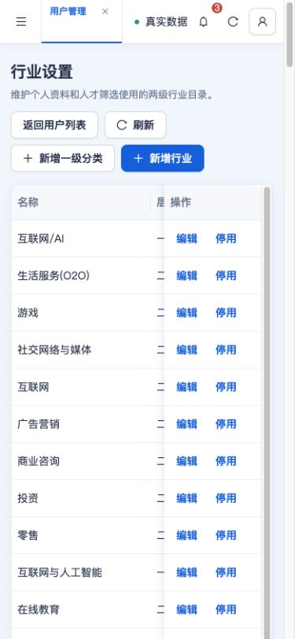

# 超级管理员行业维护与发布证据（2026-10-20）

运行代码 `325a9c3e7367ca1443a7634dd78c5c6cd970175c` 已推送 main，测试与生产后台均已发布，小程序开发版本 **`0.2.0.20261020.1` 已上传**。开发预览码已交付用户，指向测试库且支付禁用；设为体验版和真机验收仍由用户完成，未提审或发布小程序正式版。完整状态见 [verification.json](verification.json)。

入口：[测试后台](https://test.admin.mip.cool/#/users/industries)、[生产后台](https://admin.mip.cool/#/users/industries)，用户管理 → 行业设置。支持两级目录、新增、改名、归属、热门、排序和启停；仅 PLATFORM_OWNER 可维护，服务端再次校验 owner、AppID、版本与幂等键，审计包含 before / after。新增项默认停用，不物理删除历史引用。

行业初始值来自 AME 飞书 2026-09-26 revision62 快照（11类、121个子行业），导入到 `mip_tags` 后由数据库供个人资料与筛选读取，不是实时同步飞书。2026-08-22会议纪要说明两级行业与飞书表单维护；本次用户明确要求超级管理员自定义，已纳入后台验收标准 U10。后台自定义之后，旧飞书整库导入会停止，防止覆盖运营配置。官方 Figma 的读取与六枚 SVG 下载已验证，见[连通证据](../figma-official-20261019/README.md)。

## 测试与实际网页

完整 `TZ=Asia/Shanghai pnpm verify:all` 通过：小程序1811项、Web Node329项、Web React252项；包括构建、预算、源码与响应式检查。响应异常专项27项通过，其中新增5项。runtime:preflight通过。本机日志位于忽略目录 `.tmp/industry-config-20261019/release-trial-approved.log`。

测试和生产各15/15个HTTPS静态文件逐字节匹配，各68项登录及14个读模块检查通过。两端均引用新入口 `index-BVuAu-ME.js`，保留旧哈希资源。见[测试静态资源](test-assets-verification.json)、[测试HTTPS检查](test-https-verification.json)、[生产静态资源](production-assets-verification.json)、[生产HTTPS检查](production-https-verification.json)。

真实测试接口完成新增、改名、热门/排序保存、重复名称拒绝、过期版本拒绝、停用父分类拒绝新增启用子项等检查。新网页再次完成编辑、保存、刷新与重新打开回读，停用测试条目的排序由99993变为99994；两条测试目录均保持停用。生产仅做行业读取（152项），没有新增或修改生产行业数据。生产1280×720、1440×900、390×844视口均无整页横向溢出，手机侧栏折叠，表格在自身容器内展示，见[视口数据](production-viewport-checks.json)。DOM行数含表格测量行，不是业务记录数。

早期网页提交曾收到一次非标准响应；当时服务端回读仍为旧值，同一幂等键重试后成功。用户已确认修正异常处理：写请求遇到HTML/非标准响应时显示“提交结果暂时无法确认，请刷新核对后重试”，读请求使用读取失败提示；不自动重发，人工重试保留相同幂等键，业务错误保留原义。回归已通过并发布。原始间歇性非标准响应的根因仍证据不足，不能宣称根因已修复；旧[异常截图](industry-save-error.png)仅作历史记录。

## 停用后的历史保留

用户确认：仅限制新选择，历史选择保留；停用一级分类后，其下行业从新选项隐藏，但不删除原数据。个人资料快照返回原行业ID/名称；已有引用可保留，新选择检查行业和父分类启用。目录失败可继续保存其他资料；省略行业字段保留，显式 null 清除，兼容旧客户端。后台机会、案例及人才/公开资料消费者同步核对。

微信开发者工具连接真实测试库后，实际完成选择保存、停用行业后保存、停用父分类后保存、清除以及拒绝新增停用行业。旧编译会话的页面锁曾导致重复调用没有发出请求，前一轮重复保存结论已撤回；完整重新编译、重连后逐次核对真实写入版本3→4→5→6→7，每次确认离开页面，再新建页面等待服务端读取完成。最终原行业恢复为空；新增停用行业返回“资料标签不存在或当前不可用”，重读仍为空、版本仍为7。两条验收目录只存在于测试库。[运行时逐项结果](runtime-industry-retention.json)。以上为开发者工具与云端证据，真机验收待用户执行。

## 云端发布与生产保护

测试库迁移111完成，identity/opportunities/admin/BFF已更新。用户确认后，将测试账本支付模式从live改为disabled，并补齐测试会籍维护配置；账本8个运行源码文件保持不变，未写入订单或权益。测试支付适配器保持禁止客户端直调。[测试配置修正](test-ledger-config-verification.json)及[完整测试云检查](test-cloud-verification.json)通过。

生产发布前完成仓库外完整备份：154表、5521行，2026-10-20 04:45:53 UTC完成，row-count-verified，见[摘要](production-backup-summary.json)。生产追加兼容迁移110（支付尝试可空JSON列）和111（行业版本列），部署identity/opportunities/media/admin/BFF；媒体接口为后台已有富文本解析依赖。9个测试/生产函数包下载回读，运行源码与发布基点一致；原角色、网络、权限、触发器保留，BFF仅更新代码指纹配置。见[函数包核对](cloud-release-verification.json)。

最终检查发现生产旧登录回调被部署默认值覆盖，已恢复为部署前地址并保留新站分流；代码包及其他配置不变。重新核对原生健康探针与[完整生产云检查](production-cloud-verification.json)均通过，见[登录路由保护](production-login-routing-verification.json)。

生产支付账本未部署或改配置，仍为production / LIVE / live，见[账本保护](production-ledger-verification.json)。本批未写入生产订单或会员权益；`mip_orders`的2条订单和`mip_membership_entitlements`的1条权益逐字段与备份一致，见[业务数据保护](production-business-verification.json)。这些数量仅对应本批核对的MIP表，不代表旧系统所有历史订单。生产DDL、业务API发布与只读验收已完成，不能将它们描述为“生产未变更”。

## 小程序与后续交付规范

上传与开发预览使用同一份门禁通过的平铺构建，源代码基点325a9c3e，目标 `mip-t-*` / `mip_test`、支付禁用，平台主包1,754,883字节。二维码保存在仓库外并已展示给用户，未写入本目录。[上传摘要](mini-program-upload.json)。用户可在微信公众平台版本管理找到 `0.2.0.20261020.1`，设为体验版后分发；当前交付码为开发预览码。手机号、支付、订阅消息、扫码签到等真机项仍待验收。

根目录 [AGENTS.md](../../../../AGENTS.md) 已增加后续通用规则：左修改前、中修改后、右当前权威原型；逐项核对素材与角色映射；真实数据与功能优先；缺素材、冲突或不清楚的地方提前确认；保存须用新页面/新请求回读；发布保留未授权变更的配置与权限。原来的 `industry-1280/1440/390.png` 等为本地隔离内存夹具截图，不能混作真实云端或原型截图。
