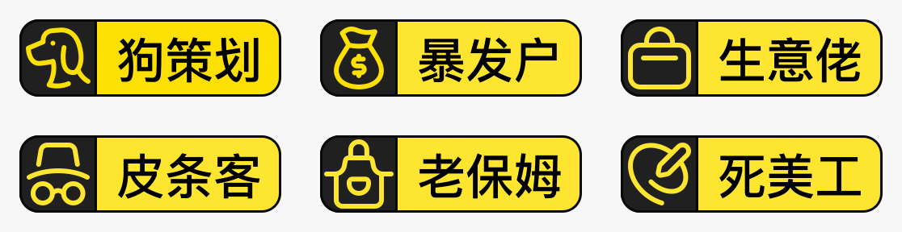

# 六角色标签原始矢量（2026-10-19）

来源：[用户指定的 Figma MIP · 机会 · 标签在这里](https://www.figma.com/design/qqkbdlh4c4Swubum8S3F2f/MIP?node-id=4197-38017)，画框 `4197:38017`（375×271）。通过 Figma 自带 SVG 导出下载，未描摹或重画。完整原始 SVG、六枚纯图标 SVG、六枚完整标签 SVG 与清单位于 [下载包](mip-six-role-vectors.zip)。

| 角色 | 图形 | 文件 |
| --- | --- | --- |
| 狗策划 | 狗 | dog.svg |
| 暴发户 | 钱袋 | money.svg |
| 生意佬 | 公文包 | business.svg |
| 皮条客 | 帽子眼镜 | pimp.svg |
| 老保姆 | 围裙 | nanny.svg |
| 死美工 | 调色盘与笔 | designer.svg |

## 使用与来源

- 事实来源保存在仓库设计系统的 `assets/wechat/role-tags/`，`manifest.json` 记录源文件哈希、每枚图标的原始16px画框及路径索引。
- 提取只选取图标路径，保留路径、位置和描边；原 SVG 下载保留原色。小程序按已有单色图标合同使用品牌 token。完整标签中的文字轮廓只用于原稿下载/预览，运行时角色文字仍来自后台。
- 人才卡补齐六角色映射，未知角色保留文字；后台表单、稳定角色key、接口、数据库与权限不变。
- 原四列截图不重新生成，按用户决定取消同状态重拍；本图是原稿 SVG 渲染，不冒充新小程序实拍。
- 前次开发版本 `0.2.0.20261019.4` 已上传；本次图标代码未重新上传，不在该旧包中。体验版设置和真机验收由用户后续处理。
- 本次检查见 [verification.json](verification.json)。

## 本版本导航范围

用户核对下线历史后，明确本版本保持“活动、机会、我的”三个Tab；“发现”属于下个版本功能，本次不恢复。设计和运行时验收文档已同步本版本范围。

## 分享站发布

已更新 [公开报告](https://mip-review.01mvp.com/#role-icons)，包含原始SVG逐枚及打包下载。线上36个文件与本地逐字节一致，四列结构及手机视口已核验，见 [publication.json](publication.json)。
